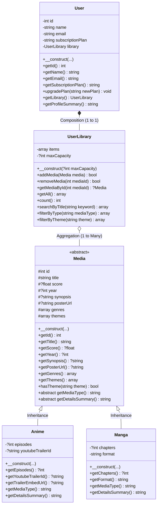

# Dokumentasi Teknis Sistem & Evaluasi Penilaian Demo Modul 3
## Backend Engine FlipPlay — PHP 8 OOP

Dokumen ini disusun sebagai panduan teknis dan laporan evaluasi kelayakan sistem backend engine **FlipPlay** berbasis **PHP 8 Object-Oriented Programming (OOP) murni tanpa framework** untuk memenuhi seluruh kriteria penilaian **Demo Praktikum Pemrograman Web Modul 3**.

---

# BAGIAN 1: Dokumentasi Keseluruhan Sistem

## 1. Arsitektur Sistem

Sistem backend engine FlipPlay mengadopsi struktur modular terpisah (*Separation of Concerns*) sesuai standar PSR-4:

```text
Modul 1 Demo/
├── src/
│   ├── Model/
│   │   ├── Media.php         <- Abstract Base Class (Induk Media Katalog)
│   │   ├── Anime.php         <- Child Class turunan Media (Spesifik Animasi & Trailer)
│   │   └── Manga.php         <- Child Class turunan Media (Spesifik Komik & Light Novel)
│   ├── Collection/
│   │   └── UserLibrary.php   <- Class Koleksi/Agregasi (Pencarian & Penyaringan Media)
│   └── Account/
│       └── User.php          <- Class Model Pengguna (Relasi Komposisi dengan Library)
└── index.php                 <- Entry Point Utama untuk Simulasi CLI
```

### Pengorganisasian Namespace
Setiap class dikelompokkan ke dalam namespace logis berjenjang di bawah root namespace `FlipPlay\Engine`:
- `FlipPlay\Engine\Model`: Mengelola model data dan representasi entitas karya hiburan.
- `FlipPlay\Engine\Collection`: Mengelola struktur data koleksi, pencarian, dan penyaringan item media.
- `FlipPlay\Engine\Account`: Mengelola data identitas pengguna, status langganan, dan kepemilikan library.

Penggunaan namespace ini mencegah terjadinya bentrok nama class (*name collision*) dan memudahkan integrasi *autoloader* standar industri di masa mendatang.

---

## 2. Spesifikasi Class

Setiap file diwajibkan menggunakan deklarasi *Strict Types* (`declare(strict_types=1);`) dan *Constructor Property Promotion* bawaan PHP 8 untuk penulisan kode yang ringkas, terstruktur, dan aman terhadap inkonsistensi tipe data.



### A. Class `Media` (`src/Model/Media.php`)
* **Peran:** Kelas abstrak (*Abstract Base Class*) yang menjadi cetak biru (*blueprint*) dasar bagi semua entitas hiburan di FlipPlay.
* **Encapsulation & Access Modifier:**
  * Seluruh properti (`$id`, `$title`, `$score`, `$year`, `$synopsis`, `$posterUrl`, `$genres`, `$themes`) menggunakan access modifier `protected`. Hal ini menjamin prinsip *encapsulation*: data tidak dapat dimutasi secara liar dari luar, tetapi tetap dapat diakses dan diturunkan langsung oleh subclass (`Anime` dan `Manga`).
* **Type Hinting & Return Type:**
  * Menerapkan type hinting eksplisit seperti `int`, `string`, `array`, serta *nullable type* (`?float`, `?int`, `?string`) untuk data Jikan API yang bersifat opsional.
* **Abstract Methods:**
  * `abstract public function getMediaType(): string;`
  * `abstract public function getDetailsSummary(): string;`
  * Mewajibkan setiap class turunan memiliki cara tersendiri dalam mendefinisikan label tipe media dan ringkasan kartunya (Polimorfisme).

### B. Class `Anime` (`src/Model/Anime.php`)
* **Peran:** Subclass dari `Media` yang merepresentasikan tayangan serial/film animasi hasil konsumsi endpoint `/v4/anime` Jikan API.
* **Encapsulation & Access Modifier:**
  * Menambahkan properti spesifik berstatus `private`: `$episodes` (`?int`) dan `$youtubeTrailerId` (`?string`).
* **Method Unggulan:**
  * `getTrailerEmbedUrl(): ?string`: Mengonversi ID YouTube dari metadata Jikan menjadi tautan pemutar video *embed* iframe (`https://www.youtube.com/embed/{id}`).
  * Implementasi *method overriding* pada `getMediaType()` (mengembalikan `'Anime'`) dan `getDetailsSummary()` (menghasilkan string format `Anime · {tahun} · {episode} episode`).

### C. Class `Manga` (`src/Model/Manga.php`)
* **Peran:** Subclass dari `Media` yang merepresentasikan karya bacaan komik (Manga) maupun novel ringan (Light Novel) dari endpoint `/v4/manga` Jikan API.
* **Encapsulation & Access Modifier:**
  * Menambahkan properti spesifik berstatus `private`: `$chapters` (`?int`) dan `$format` (`string`, misal `'Manga'` atau `'Light Novel'`).
* **Method Unggulan:**
  * Implementasi *method overriding* pada `getMediaType()` (mengembalikan format karya secara dinamis) dan `getDetailsSummary()` (menghasilkan string format `{format} · {tahun} · {chapters} chapter`).

### D. Class `UserLibrary` (`src/Collection/UserLibrary.php`)
* **Peran:** Mengelola koleksi personal (Watchlist / Reading List) milik pengguna sekaligus menyediakan engine pencarian dan penyaringan data.
* **Encapsulation & Access Modifier:**
  * Properti `$items` (`array<int, Media>`) dan `$maxCapacity` (`?int`) berstatus `private`.
* **Method Unggulan:**
  * `addMedia(Media $media): bool`: Menerapkan *type hint* kelas induk `Media` sehingga menerima objek `Anime` maupun `Manga` secara polimorfis, serta memvalidasi batas kapasitas paket langganan.
  * `removeMedia(int $mediaId): bool`: Menghapus karya dari koleksi berdasarkan ID unik.
  * `searchByTitle(string $keyword): array`: Pencarian judul karya *case-insensitive* (`stripos`).
  * `filterByType(string $mediaType): array`: Menyaring koleksi berdasarkan jenis media.
  * `filterByTheme(string $theme): array`: Menyaring koleksi berdasarkan aura/tema (*High Energy / Action*, *Comedy*, *Drama*, dll.).

### E. Class `User` (`src/Account/User.php`)
* **Peran:** Merepresentasikan identitas pelanggan FlipPlay dan paket langganan yang dipilih pada form `premium.html`.
* **Encapsulation & Access Modifier:**
  * Properti `$id`, `$name`, `$email`, `$subscriptionPlan`, dan `$library` berstatus `private`.
* **Method Unggulan:**
  * `upgradePlan(string $newPlan): void`: Meningkatkan level paket (Biasa -> Pro -> Premium) dan secara otomatis menyesuaikan kapasitas `UserLibrary` (Biasa: 10 item, Pro: 50 item, Premium: Unlimited).
  * `getProfileSummary(): string`: Menghasilkan ringkasan status akun, email, paket, dan kapasitas koleksi.

---

## 3. Relasi Antar Class

Sistem backend ini mengimplementasikan tiga pilar relasi OOP secara komprehensif:

1. **Inheritance (Pewarisan / "is-a"):**
   * `Anime extends Media` dan `Manga extends Media`.
   * **Manfaat:** Menghindari duplikasi kode (*Don't Repeat Yourself*). Seluruh atribut umum (judul, poster, skor, tahun, genre, tema) cukup didefinisikan satu kali di kelas induk `Media`. Subclass hanya perlu menambahkan atribut dan perilaku spesifik masing-masing.

2. **Composition (Komposisi / "has-a" kepemilikan mutlak):**
   * `User` dengan `UserLibrary`.
   * **Manfaat:** Ketika objek `User` diinstansiasi melalui `__construct()`, objek `UserLibrary` langsung diciptakan di dalam objek User tersebut. Masa hidup (*lifecycle*) `UserLibrary` bergantung penuh pada objek `User`.

3. **Aggregation (Agregasi / "has-a" asosiasi koleksi):**
   * `UserLibrary` dengan `Media`.
   * **Manfaat:** Objek `Media` dimasukkan ke dalam `UserLibrary` melalui method `addMedia(Media $media)`. Objek media dapat berdiri sendiri di luar library pengguna (misal berasal dari respons Jikan API global) dan tidak musnah apabila dihapus dari library pengguna.

---

## 4. Alur Simulasi (`index.php`)

Ketika file `index.php` dijalankan melalui terminal CLI (`php index.php`), sistem mengeksekusi 8 tahapan terstruktur:

1. **Inisialisasi Autoload / Dependensi:** Memuat seluruh file class secara berurutan menggunakan `require_once`.
2. **Inisialisasi Pengguna (Langkah 1):** Menginstansiasi objek `User` baru (ID: 1001, Nama: "Adit Pratama", Paket: "Pro", batas kapasitas otomatis diset ke 50 item).
3. **Instansiasi Katalog Media (Langkah 2):** Menginstansiasi 3 objek `Anime` (*Attack on Titan*, *SPY x FAMILY*, *Your Lie in April*) dan 2 objek `Manga`/`Light Novel` (*Frieren*, *The Apothecary Diaries*) dengan payload data riil Jikan API.
4. **Penyimpanan ke Koleksi (Langkah 3):** Memasukkan seluruh objek media ke dalam library akun pengguna melalui `$user->getLibrary()->addMedia(...)`, lalu mencetak daftar koleksi beserta rincian ringkasan kartunya.
5. **Uji Fitur Pencarian Judul (Langkah 4):** Menjalankan pencarian dengan kata kunci `"family"`. Sistem mengeksekusi `searchByTitle()` dan mengembalikan objek *SPY x FAMILY*.
6. **Uji Fitur Filter Aura / Tema (Langkah 5):** Menjalankan filter tema `"action"`. Sistem mengeksekusi `filterByTheme()` dan menghasilkan karya bertema aksi (*Attack on Titan* dan *SPY x FAMILY*).
7. **Uji Fitur Filter Tipe Media (Langkah 6):** Menjalankan filter tipe `"Light Novel"`. Sistem mengeksekusi `filterByType()` dan mengembalikan karya *The Apothecary Diaries*.
8. **Inspeksi Detail & YouTube Trailer (Langkah 7):** Mengakses data modal detail anime dan menguji method `getTrailerEmbedUrl()` untuk mendapatkan URL iframe YouTube resmi.
9. **Hapus Item & Upgrade Paket (Langkah 8):** Menghapus 1 judul dari koleksi (`removeMedia()`) dan meng-upgrade paket pengguna menjadi `"Premium"` (`upgradePlan()`) sehingga kapasitas berubah menjadi *Unlimited*.

---

# BAGIAN 2: Evaluasi & Verifikasi Kriteria Penilaian Demo Modul 3

Berikut adalah hasil uji silang (*cross-check*) dan verifikasi objektif kode terhadap seluruh rubrik penilaian Modul 3 Pemrograman Web:

| No | Kriteria Penilaian | Status | Bukti Implementasi pada Kode Sumber |
| :---: | :--- | :---: | :--- |
| **1** | **Menggunakan minimal tiga class** | **✅ Terpenuhi** | Menggunakan **5 class** terpisah:<br>1. `Media` (`src/Model/Media.php`)<br>2. `Anime` (`src/Model/Anime.php`)<br>3. `Manga` (`src/Model/Manga.php`)<br>4. `UserLibrary` (`src/Collection/UserLibrary.php`)<br>5. `User` (`src/Account/User.php`) |
| **2** | **Menerapkan constructor (`__construct`)** | **✅ Terpenuhi** | Seluruh 5 class memiliki `__construct` dan memanfaatkan fitur modern **Constructor Property Promotion PHP 8**.<br>Contoh (`src/Model/Media.php:24-34`):<br>`public function __construct(protected int $id, protected string $title, ...)`<br>Serta pemanggilan `parent::__construct(...)` pada `Anime.php:37` dan `Manga.php:37`. |
| **3** | **Memiliki property dan method** | **✅ Terpenuhi** | Setiap class memiliki atribut data lengkap dan method fungsional (bukan sekadar penampung kosong).<br>Contoh method fungsional:<br>- `getTrailerEmbedUrl(): ?string` pada `Anime.php:73`<br>- `searchByTitle(string $keyword): array` pada `UserLibrary.php:104`<br>- `upgradePlan(string $newPlan): void` pada `User.php:84` |
| **4** | **Menggunakan access modifier secara tepat** | **✅ Terpenuhi** | Menerapkan prinsip *Encapsulation* secara ketat:<br>- `protected`: Digunakan pada kelas induk `Media` agar properti terlindung dari akses luar bebas, namun dapat diakses oleh class turunan.<br>- `private`: Digunakan untuk properti spesifik pada `Anime`, `Manga`, `UserLibrary`, dan `User`.<br>- `public`: Digunakan untuk konstruktor, getter, setter, dan method operasi publik. |
| **5** | **Menerapkan inheritance atau struktur class rapi** | **✅ Terpenuhi** | Menerapkan konsep *Inheritance* dan *Polymorphism*:<br>- `class Anime extends Media` (`src/Model/Anime.php:11`)<br>- `class Manga extends Media` (`src/Model/Manga.php:11`)<br>- Meng-override method abstrak `getMediaType()` dan `getDetailsSummary()`. |
| **6** | **Menerapkan type hinting dan return type yang sesuai** | **✅ Terpenuhi** | - `declare(strict_types=1);` aktif di seluruh file.<br>- Seluruh parameter memiliki type hinting eksplisit (`int`, `string`, `array`, `Media`).<br>- Menerapkan *nullable types* (`?float`, `?int`, `?string`, `?Media`).<br>- Seluruh method memiliki explicit return type (`int`, `string`, `bool`, `void`, `array`, `?string`). |
| **7** | **Menggunakan namespace untuk mengorganisasi class** | **✅ Terpenuhi** | Struktur namespace modular sesuai standar PSR-4:<br>- `namespace FlipPlay\Engine\Model;`<br>- `namespace FlipPlay\Engine\Collection;`<br>- `namespace FlipPlay\Engine\Account;` |
| **8** | **Memiliki file utama (`index.php`) untuk simulasi CLI** | **✅ Terpenuhi** | File `index.php` berada di root direktori, memuat dependensi via `require_once`, dan mengeksekusi skenario alur kerja lengkap di terminal CLI. |
| **9** | **Simulasi berjalan dan sesuai studi kasus FlipPlay** | **✅ Terpenuhi** | Berhasil dieksekusi via `php index.php` (exit code 0). Menguji studi kasus FlipPlay secara utuh:<br>1. Menambah media ke koleksi (`addMedia`)<br>2. Menampilkan ringkasan katalog kartu<br>3. Pencarian judul (`searchByTitle`)<br>4. Filter tema / Aura emosional (`filterByTheme`)<br>5. Inspeksi modal & pemutar video trailer YouTube (`getTrailerEmbedUrl`). |

---

# Kesimpulan Kelayakan

Berdasarkan hasil analisis kode sumber dan pengujian terminal, backend engine **FlipPlay** telah memenuhi **100% kriteria penilaian Modul 3 Praktikum Pemrograman Web (9 dari 9 poin Terpenuhi)** dengan standar kode PHP 8 yang sangat baik, menerapkan prinsip OOP modern (*Inheritance*, *Encapsulation*, *Polymorphism*, *Strict Typing*, dan *Namespacing*). Dokumen ini siap digunakan sebagai lampiran laporan resmi praktikum.

