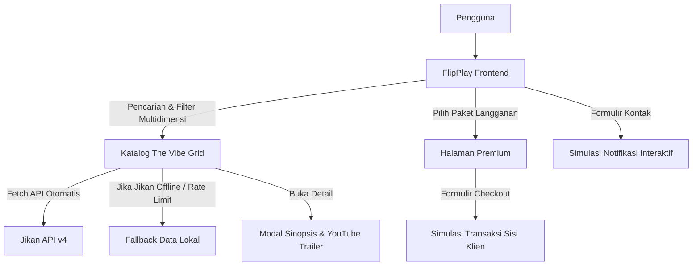

# Laporan Progres & Penjelasan Teknis Aplikasi Web FlipPlay

Dokumen ini menyajikan status progres pengembangan, arsitektur teknis, daftar fitur yang sudah selesai, serta batasan fungsional dari aplikasi web **FlipPlay**.

---

## 1. Ringkasan Eksekutif & Status Proyek

Aplikasi **FlipPlay** saat ini berada pada tahap **Prototipe Front-End Interaktif Berfungsi Penuh (Tahap Modul 1 Selesai)**. 

Aplikasi ini mendemonstrasikan antarmuka platform hiburan digital modern (*all-in-one entertainment hub*) yang menggabungkan katalog Anime, Film & Series (Drama), Manga, serta Light Novel, dilengkapi dengan halaman penawaran paket berlangganan (*subscription plans*).

---

## 2. Struktur Berkas & Arsitektur Proyek

Struktur berkas kerja pada repositori ini adalah sebagai berikut:

| Berkas / Direktori | Peran & Deskripsi |
| :--- | :--- |
| `dev-server.js` | Server lokal development berbasis Node.js murni (`http`, `fs`, `path`) yang melayani aset statis pada port 4173. |
| `node_modules/src/index.html` | Halaman utama web (*Landing Page*): Hero, Navigasi, The Vibe Grid, Layanan Unggulan, Kontak, dan Footer. |
| `node_modules/src/premium.html` | Halaman paket berlangganan (*Biasa*, *Pro*, *Premium*) dan formulir simulasi checkout. |
| `node_modules/src/script.js` | Logika interaktivitas JavaScript: konsumsi API, pencarian real-time, filter komposit, modal dialog, dan fallback. |
| `node_modules/src/main.css` | Sumber konfigurasi dan utilitas Tailwind CSS v4. |
| `node_modules/src/output.css` | Berkas CSS terkompilasi (*build output*) yang digunakan oleh HTML. |
| `package.json` | Konfigurasi dependensi (`tailwindcss`, `@tailwindcss/cli`) dan skrip dev server (`npm run dev`, `npm run build:css`). |

> [!NOTE]
> Saat ini berkas aplikasi berada di dalam subfolder `node_modules/src/`. Meskipun berjalan normal di server dev lokal, secara standar arsitektur web modern berkas kode sumber sebaiknya dipindahkan ke folder `src/` di luar `node_modules`.

---

## 3. Fitur yang Sudah Selesai & Berjalan (100% Client-Side)

### A. Navigasi & Tampilan Responsif (UI/UX)
- **Desain Modern:** Dibangun menggunakan Tailwind CSS dengan skema warna konsisten, kartu berbayang (*card shadows*), dan efek transisi hover.
- **Navigasi Mulus (*Smooth Scrolling*):** Pengguna dapat berpindah antar-section (*Beranda*, *Anime*, *Layanan*, *Kontak*) secara halus.
- **Menu Mobile Interaktif:** Terdapat navigasi *hamburger menu* yang responsif dan dapat dibuka-tutup dengan rapi pada layar smartphone dan tablet.

### B. Katalog Pintar "The Vibe Grid"
- **Integrasi Jikan API (v4):** Mengambil data terkini secara otomatis dari MyAnimeList untuk Anime, Manga, dan Light Novel.
- **Pencarian Real-Time (*Live Search*):** Pengguna dapat mengetikkan judul pada kolom pencarian dan kartu langsung tersaring seketika tanpa *page reload*.
- **Filter Multidimensi:**
  1. *Filter Jenis Media:* Semua, Anime, Film & Series, Manga, Light Novel.
  2. *Filter Tema:* Fantasy, Romance, Comedy, Action, Mystery, Slice of Life.
  3. *Filter Aura Emosional:* High Energy (Action), Melancholy (Drama), Binge Mode (Comedy).
  4. *Multi-filter:* Filter dapat digabungkan secara bersamaan dengan kata kunci pencarian.

### C. Pop-up Modal Interaktif (Sinopsis & Trailer)
- Menggunakan elemen HTML5 native `<dialog>` dengan latar belakang *backdrop blur*.
- Dilengkapi dengan *video player* trailer resmi YouTube yang disematkan langsung (*embed iframe*).
- Menampilkan metadata komprehensif: judul, poster resolusi penuh, skor MAL, tahun rilis, jumlah episode/chapter, dan sinopsis lengkap.
- Terdapat tombol navigasi keluar (*external link*) menuju trailer YouTube.

### D. Sistem Ketahanan Jaringan (*Reliability & Fallback*)
- **Penanganan Rate-Limiting:** Menerapkan jeda eksekusi (*throttling*) 400ms antar-endpoint Jikan.
- **Batas Waktu (*Timeout*):** Permintaan jaringan dibatasi maksimal 20 detik menggunakan `AbortController`.
- **Fallback Data Lokal Otomatis:** Jika Jikan API mati, mengalami pemblokiran *rate limit* (HTTP 429), atau perangkat sedang offline, sistem secara otomatis beralih menyajikan data lokal (`LOCAL_CATALOG`). Tampilan tidak akan pernah kosong atau *error*.
- **Tombol Coba Lagi (*Retry Button*):** Menyediakan opsi bagi pengguna untuk meminta ulang data live tanpa harus menyegarkan (*refresh*) seluruh halaman.
- **Fallback Poster SVG Dinamis:** Jika gambar sampul gagal dimuat dari server eksternal, kartu otomatis merender placeholder visual SVG elegan secara lokal.

### E. Halaman Premium & Alur Checkout
- **Komparasi 3 Paket:** Paket *Biasa* (Rp29.000/bln), *Pro* (Rp59.000/bln), dan *Premium* (Rp89.000/bln) dengan rincian fitur lengkap.
- **Interaksi Satu Klik:** Memilih salah satu tombol paket akan otomatis memasukkan nama dan harga paket ke formulir checkout serta mengarahkan layar secara mulus ke formulir pembayaran.
- **Validasi Formulir:** Validasi HTML5 untuk nama lengkap, email, dan pilihan metode pembayaran (Virtual Account, E-Wallet, Kartu Kredit).
- **Status Simulasi:** Menampilkan kotak konfirmasi keberhasilan simulasi pemesanan.

---

## 4. Matriks Status Fitur

| Komponen / Fitur | Status Pengerjaan | Keterangan Teknis |
| :--- | :---: | :--- |
| **Hero & Landing Page** | Selesai (100%) | Visual interaktif, CTA button, tata letak responsif |
| **Katalog Anime** | Selesai (100%) | Live API via Jikan v4 dengan fallback lokal |
| **Katalog Manga & Light Novel** | Selesai (100%) | Live API via Jikan v4 dengan fallback lokal |
| **Katalog Film & Drama** | Selesai (100%) | Berfungsi penuh menggunakan data lokal terstruktur |
| **Live Search & Filter Aura** | Selesai (100%) | Berjalan di sisi klien dengan DOM updating instan |
| **Modal Detail & Player Trailer** | Selesai (100%) | Native Dialog, API enrichment, YouTube Embed |
| **Halaman & Formulir Premium** | Selesai (100%) | Simulasi front-end penuh dengan validasi input |
| **Formulir Kontak** | Selesai (100%) | Interaksi tombol alert feedback di sisi browser |
| **Autentikasi Akun User** | Belum Dibuat | Membutuhkan backend & database (tahap lanjutan) |
| **Streaming Pemutar Video Asli** | Belum Dibuat | Saat ini pemutaran sebatas trailer resmi YouTube |
| **Payment Gateway Nyata** | Belum Dibuat | Memerlukan penyedia seperti Midtrans/Xendit |

---

## 5. Batasan Saat Ini (Scope Modul 1 vs Produksi Nyata)

1. **Sisi Penyimpanan Data (Backend & Database):**
   Aplikasi ini belum memiliki server backend khusus (seperti Express.js, Laravel, dsb.) maupun basis data (seperti PostgreSQL, MySQL, atau Supabase). Seluruh data transaksi, akun, dan pesan kontak masih bersifat simulasi sesi browser.
2. **Kategori Film & Series (Drama):**
   Kategori drama saat ini mengambil data dari array statis lokal (`LOCAL_CATALOG`), karena Jikan API berfokus pada database MyAnimeList (anime & komik Jepang).
3. **Penyajian Konten:**
   Aplikasi berfungsi sebagai katalog penemuan (*discovery catalog*) dan promosi paket, belum menyediakan pemutar video penuh (*full-length video streaming*) maupun pembaca buku digital (*manga reader viewer*).

---

## 6. Roadmap Pengembangan Lanjutan yang Disarankan

Untuk peningkatan ke tingkat lanjutan (misal: Modul 2 / Modul Backend), langkah yang dapat diambil:

1. **Penataan Struktur Direktori:**
   Memindahkan isi folder `node_modules/src/` ke folder khusus `src/` atau `public/` di tingkat root repositori agar `node_modules` murni hanya berisi modul paket npm.
2. **Integrasi TMDB API untuk Drama:**
   Menghubungkan endpoint Film & Series ke *The Movie Database (TMDB) API* agar kategori drama mendapatkan metadata dan trailer live dari internet sama seperti anime.
3. **Penyimpanan Data Pengguna (Backend / BaaS):**
   Mengintegrasikan Supabase atau Firebase untuk menyimpan formulir pendaftaran langganan pengguna dan pesan kontak.
4. **Implementasi Autentikasi Pengguna:**
   Menyediakan fitur registrasi dan login akun agar pengguna dapat menyimpan daftar tontonan favorit (*watchlist*).

