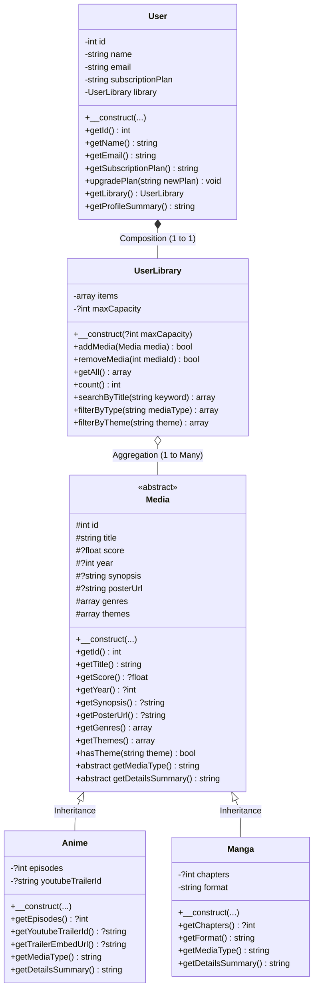
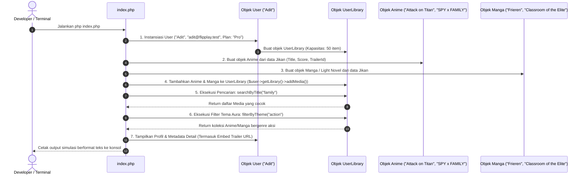

# Dokumentasi Rancangan Backend PHP OOP — FlipPlay Engine

Dokumentasi ini menyajikan arsitektur dan rancangan backend berorientasi objek (PHP OOP murni tanpa framework) untuk mesin katalog digital **FlipPlay**, hasil pemetaan langsung dari data front-end dan Jikan API v4 yang sedang digunakan.

---

## 1. Pemetaan Front-End & Jikan API ke Domain Backend

Berdasarkan analisis file front-end (`script.js`, `index.html`, dan `premium.html`), elemen UI dan payload data Jikan v4 dipetakan ke konsep OOP berikut:

| Data Front-End / Jikan API | Peran di UI FlipPlay | Representasi Backend OOP |
| :--- | :--- | :--- |
| `title`, `score`, `year`, `synopsis`, `images` | Kartu "The Vibe Grid" & Modal Sinopsis | Class Abstrak `Media` (Induk) |
| `episodes`, `trailer.youtube_id` | Metadata kartu & iframe video player trailer | Class `Anime` (Turunan `Media`) |
| `chapters`, `format` (Manga / Light Novel) | Metadata kartu bacaan & badge format | Class `Manga` (Turunan `Media`) |
| Data checkout (nama, email, tier paket) | Formulir paket langganan (Biasa, Pro, Premium) | Class `User` |
| Filter media, filter tema/aura, search bar | Navigasi interaktif filter katalog | Class `UserLibrary` (Collection) |

---

## 2. Diagram Kelas (Class Diagram UML)

---

## 3. Spesifikasi Rinci Entitas (Class, Properties, Methods)

Semua class menggunakan namespace `FlipPlay\Engine`, standar *Strict Types* (`declare(strict_types=1);`), serta pembatasan hak akses (*encapsulation*) dengan access modifier (`private`, `protected`, `public`).

### A. Class Abstrak: `Media`
Berfungsi sebagai *blueprint* (kelas induk) untuk semua tipe hiburan yang ada di FlipPlay.

- **Namespace:** `FlipPlay\Engine\Model`
- **Konsep:** *Inheritance / Abstraction*

#### Atribut (Properties):
| Property | Visibility | Type Hinting | Keterangan Data Jikan API |
| :--- | :--- | :--- | :--- |
| `$id` | `protected` | `int` | ID unik dari MyAnimeList (`mal_id`). |
| `$title` | `protected` | `string` | Judul karya (`item.title` / `item.title_english`). |
| `$score` | `protected` | `?float` | Skor rating komunitas (`item.score`, misal `8.5`). Nullable. |
| `$year` | `protected` | `?int` | Tahun rilis (`item.year` / `published.from`). Nullable. |
| `$synopsis` | `protected` | `?string` | Sinopsis narasi untuk modal detail (`item.synopsis`). |
| `$posterUrl` | `protected` | `?string` | URL poster (`images.webp.large_image_url`). |
| `$genres` | `protected` | `array` | Daftar nama genre (`['Action', 'Fantasy']`). |
| `$themes` | `protected` | `array` | Tag tema/aura (`['action', 'comedy', 'slice-of-life']`). |

#### Perilaku (Methods):
| Method | Visibility | Parameter | Return Type | Fungsi |
| :--- | :--- | :--- | :--- | :--- |
| `__construct(...)` | `public` | Sesuai atribut di atas | `void` | Menginisialisasi objek media secara valid. |
| `getId()` | `public` | - | `int` | Mengambil ID media. |
| `getTitle()` | `public` | - | `string` | Mengambil judul media. |
| `getScore()` | `public` | - | `?float` | Mengambil skor rating. |
| `getYear()` | `public` | - | `?int` | Mengambil tahun rilis. |
| `getSynopsis()` | `public` | - | `?string` | Mengambil sinopsis lengkap. |
| `getPosterUrl()` | `public` | - | `?string` | Mengambil link gambar sampul. |
| `getGenres()` | `public` | - | `array` | Mengembalikan array list genre. |
| `getThemes()` | `public` | - | `array` | Mengembalikan array list tema/aura. |
| `hasTheme(string $theme)` | `public` | `string $theme` | `bool` | Mengecek apakah media memiliki tema tertentu (case-insensitive). |
| `getMediaType()` | `public abstract` | - | `string` | Method abstrak untuk identitas jenis media ("Anime", "Manga", dsb.). |
| `getDetailsSummary()` | `public abstract` | - | `string` | Method abstrak untuk menghasilkan teks format ringkas kartu media. |

---

### B. Class Turunan: `Anime` (Extends `Media`)
Mewarisi seluruh atribut `Media` dan menambahkan perilaku khusus tayangan animasi (episode & trailer video YouTube).

- **Namespace:** `FlipPlay\Engine\Model`
- **Konsep:** *Inheritance (Pewarisan)*

#### Atribut Tambahan:
| Property | Visibility | Type Hinting | Keterangan Data Jikan API |
| :--- | :--- | :--- | :--- |
| `$episodes` | `private` | `?int` | Jumlah total episode serial anime (`item.episodes`). |
| `$youtubeTrailerId` | `private` | `?string` | ID trailer YouTube untuk video embed (`trailer.youtube_id`). |

#### Perilaku Tambahan & Override:
| Method | Visibility | Parameter | Return Type | Fungsi |
| :--- | :--- | :--- | :--- | :--- |
| `__construct(...)` | `public` | Parameter induk + `$episodes`, `$youtubeTrailerId` | `void` | Memanggil `parent::__construct()` lalu mengisi properti lokal. |
| `getEpisodes()` | `public` | - | `?int` | Mengembalikan jumlah episode. |
| `getYoutubeTrailerId()` | `public` | - | `?string` | Mengembalikan ID trailer YouTube. |
| `getTrailerEmbedUrl()` | `public` | - | `?string` | Menghasilkan link iframe YouTube (`https://www.youtube.com/embed/{id}`). |
| `getMediaType()` | `public` | - | `string` | Override: mengembalikan string `"Anime"`. |
| `getDetailsSummary()` | `public` | - | `string` | Override: mengembalikan string `"Anime · {year} · {episodes} episode"`. |

---

### C. Class Turunan: `Manga` (Extends `Media`)
Mewarisi `Media` dan merepresentasikan komik/manga maupun light novel di FlipPlay.

- **Namespace:** `FlipPlay\Engine\Model`
- **Konsep:** *Inheritance (Pewarisan)*

#### Atribut Tambahan:
| Property | Visibility | Type Hinting | Keterangan Data Jikan API |
| :--- | :--- | :--- | :--- |
| `$chapters` | `private` | `?int` | Jumlah chapter bacaan yang tersedia (`item.chapters`). |
| `$format` | `private` | `string` | Format publikasi ("Manga" atau "Light Novel"). |

#### Perilaku Tambahan & Override:
| Method | Visibility | Parameter | Return Type | Fungsi |
| :--- | :--- | :--- | :--- | :--- |
| `__construct(...)` | `public` | Parameter induk + `$chapters`, `$format` | `void` | Memanggil `parent::__construct()` dan menetapkan format. |
| `getChapters()` | `public` | - | `?int` | Mengembalikan jumlah chapter. |
| `getFormat()` | `public` | - | `string` | Mengembalikan format ("Manga" / "Light Novel"). |
| `getMediaType()` | `public` | - | `string` | Override: mengembalikan nilai `$this->format`. |
| `getDetailsSummary()` | `public` | - | `string` | Override: mengembalikan string `"{format} · {year} · {chapters} chapter"`. |

---

### D. Class: `UserLibrary` (Collection Management)
Mengelola koleksi media milik pengguna (Watchlist / Reading List / Bookmark) serta mengimplementasikan logika pencarian dan penyaringan data secara efisien.

- **Namespace:** `FlipPlay\Engine\Collection`
- **Konsep:** *Aggregation & Data Manipulation*

#### Atribut:
| Property | Visibility | Type Hinting | Keterangan |
| :--- | :--- | :--- | :--- |
| `$items` | `private` | `array` | Wadah asosiatif `[mediaId => Media]` untuk menampung objek turunan `Media`. |
| `$maxCapacity` | `private` | `?int` | Batas maksimum item koleksi berdasarkan tier langganan pengguna. |

#### Perilaku:
| Method | Visibility | Parameter | Return Type | Fungsi |
| :--- | :--- | :--- | :--- | :--- |
| `__construct(?int $maxCapacity = null)` | `public` | Kapasitas maksimal | `void` | Menyiapkan array koleksi kosong dan batas kapasitas. |
| `addMedia(Media $media)` | `public` | `Media $media` | `bool` | Menambah item ke koleksi. Return `false` jika ID sudah ada atau kapasitas penuh. |
| `removeMedia(int $mediaId)` | `public` | `int $mediaId` | `bool` | Menghapus item dari koleksi berdasarkan ID. |
| `getAll()` | `public` | - | `array` | Mengembalikan seluruh objek `Media[]` di koleksi. |
| `count()` | `public` | - | `int` | Menghitung jumlah item tersimpan saat ini. |
| `searchByTitle(string $keyword)` | `public` | `string $keyword` | `array` | Melakukan pencarian judul *case-insensitive* (`stripos`). |
| `filterByType(string $mediaType)` | `public` | `string $mediaType` | `array` | Memfilter koleksi berdasarkan tipe ("Anime", "Manga", "Light Novel"). |
| `filterByTheme(string $theme)` | `public` | `string $theme` | `array` | Memfilter koleksi berdasarkan tag aura/tema ("action", "comedy", dsb.). |

---

### E. Class: `User`
Merepresentasikan pengguna FlipPlay sesuai formulir checkout di `premium.html`.

- **Namespace:** `FlipPlay\Engine\Account`
- **Konsep:** *Composition (Setiap User memiliki satu `UserLibrary`)*

#### Atribut:
| Property | Visibility | Type Hinting | Keterangan |
| :--- | :--- | :--- | :--- |
| `$id` | `private` | `int` | ID unik pengguna. |
| `$name` | `private` | `string` | Nama lengkap pengguna (`#customer-name`). |
| `$email` | `private` | `string` | Alamat email terdaftar (`#customer-email`). |
| `$subscriptionPlan`| `private` | `string` | Paket langganan ("Biasa", "Pro", "Premium"). |
| `$library` | `private` | `UserLibrary` | Objek koleksi personal pengguna. |

#### Perilaku:
| Method | Visibility | Parameter | Return Type | Fungsi |
| :--- | :--- | :--- | :--- | :--- |
| `__construct(...)` | `public` | `$id`, `$name`, `$email`, `$subscriptionPlan` | `void` | Menginisialisasi user dan membuat objek `UserLibrary` sesuai limit paket. |
| `getId()` | `public` | - | `int` | Mengambil ID pengguna. |
| `getName()` | `public` | - | `string` | Mengambil nama pengguna. |
| `getEmail()` | `public` | - | `string` | Mengambil email. |
| `getSubscriptionPlan()` | `public` | - | `string` | Mengambil nama paket saat ini. |
| `upgradePlan(string $newPlan)` | `public` | `string $newPlan` | `void` | Mengubah paket langganan dan memperbarui limit `UserLibrary`. |
| `getLibrary()` | `public` | - | `UserLibrary` | Mengakses objek koleksi pribadi milik pengguna. |
| `getProfileSummary()` | `public` | - | `string` | Menghasilkan ringkasan akun dan jumlah simpanan koleksi. |

---

## 4. Alur Simulasi (Use Case di `index.php`)

Skenario langkah demi langkah eksekusi pada satu file entry-point CLI (`index.php`):

### Langkah Skenario Eksekusi:
1. **Langkah 1 (Inisialisasi Pengguna):** Membuat profil akun baru `User` yang memilih paket langganan `"Pro"` berdasarkan formulir checkout `premium.html`.
2. **Langkah 2 (Pembuatan Entitas Media):** Menginstansiasi instance objek `Anime` (misal *Attack on Titan*, *SPY x FAMILY*, *Demon Slayer*) dan `Manga` (misal *Frieren*, *Classroom of the Elite*) menggunakan payload data yang identik dengan Jikan API.
3. **Langkah 3 (Penyimpanan ke Koleksi Pribadi):** Memasukkan objek-objek tersebut ke dalam library pengguna (`$user->getLibrary()->addMedia(...)`).
4. **Langkah 4 (Pengujian Pencarian Real-Time):** Menjalankan simulasi search bar front-end (`#anime-search`) melalui pemanggilan method `$library->searchByTitle("family")`.
5. **Langkah 5 (Pengujian Filter Aura / Tema):** Menjalankan filter *High Energy (Action)* dengan memanggil `$library->filterByTheme("action")` untuk memastikan polimorfisme berjalan baik pada `Anime` maupun `Manga`.
6. **Langkah 6 (Inspeksi Detail & Video Player):** Mengakses data modal interaktif (sinopsis dan URL embed video YouTube) pada objek `Anime`.
7. **Langkah 7 (Simulasi Upgrade Paket):** Menyimulasikan upgrade paket akun pengguna dari *Pro* ke *Premium*.

